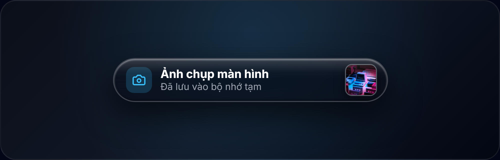
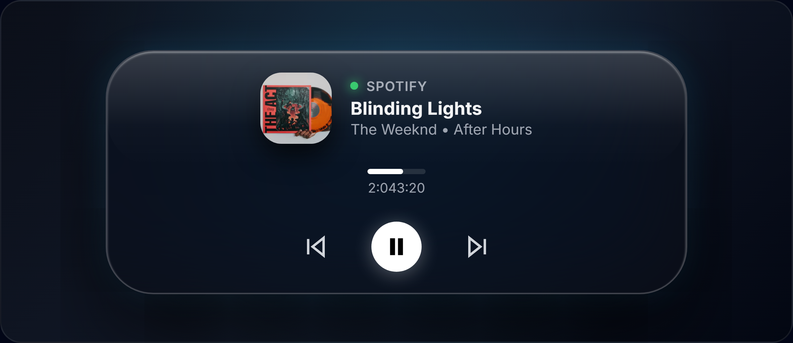
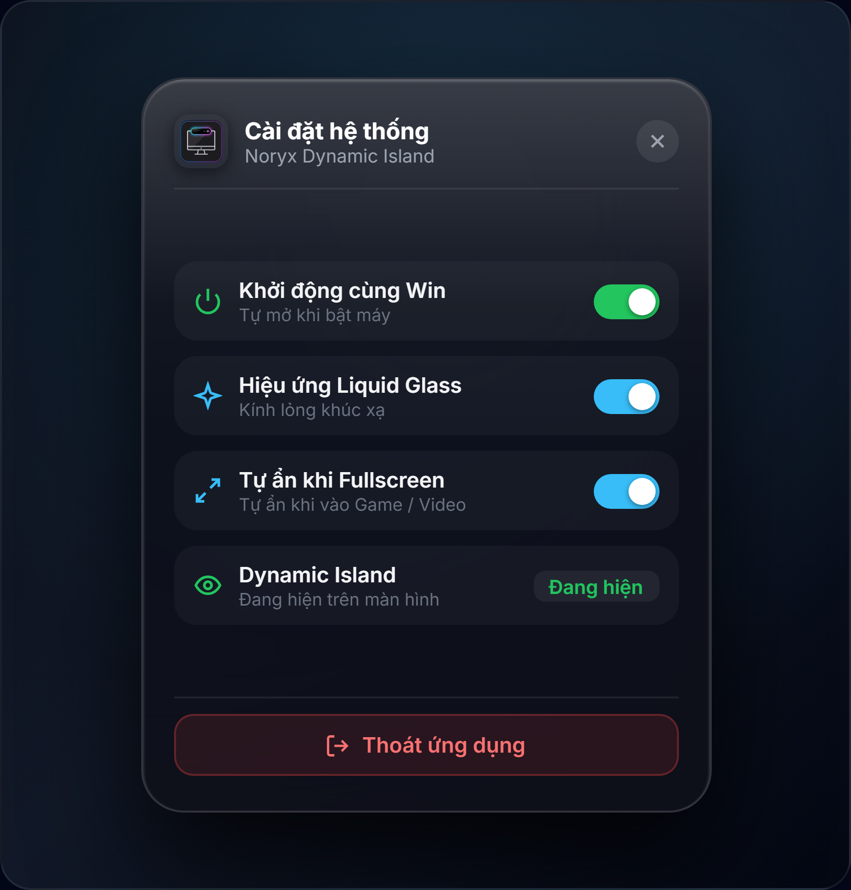

<div align="center">


# Noryx Dynamic Island for Windows

**Trải nghiệm Dynamic Island đẳng cấp Apple trên Windows 10 & 11**  
*An ultra-refined, fluid Dynamic Island built with Tauri v2, Rust & React 19.*

[](https://github.com/noryx/dynamic-island/releases)
[](https://github.com)
[](https://tauri.app)
[](https://www.rust-lang.org)
[](https://react.dev)
[](LICENSE)

<br/>

[Tải về bản cài đặt (Releases)](#-tải-về-và-cài-đặt-download--releases) • [Xem trước giao diện (Demos)](#-xem-trước-giao-diện-visual-demos) • [Tính năng nổi bật](#-tính-năng-nổi-bật-features) • [Cử chỉ & Phím tắt](#-cử-chỉ--phím-tắt-shortcuts--gestures) • [Quy trình đóng gói GitHub (GitHub Packaging)](#-quy-trình-đóng-gói-lên-github-releases-github-packaging)

</div>

---

## 📸 Xem trước giao diện (Visual Demos)

<div align="center">

### 1. Trạng thái thu gọn tinh tế (Compact Pill)
Thời tiết thực tế, tốc độ tải mạng thời gian thực (`14.5 MB/s`), đồng hồ giờ/phút sắc nét font **Inter** kết hợp chỉ số quyền riêng tư Microphone & Camera.


<br/><br/>

### 2. Trình phát nhạc & Sóng âm nhịp nhàng (Music Island)
Tự động đồng bộ với Spotify, YouTube, Apple Music qua Windows GSMTC kèm ảnh bìa album và sóng âm tần số.


<br/><br/>

### 3. Xem trước Ảnh chụp màn hình tức thì (Screenshot Preview HUD)
Khi bấm `Win + Shift + S` hoặc `PrtScn`, đảo lập tức hiển thị ảnh thumbnail thu nhỏ của chính bức ảnh vừa chụp.



<br/><br/>

### 4. Trình phát đa phương tiện mở rộng (Expanded Card)
Click vào đảo để mở thẻ trình phát nhạc cao cấp: Ảnh bìa lớn, tên bài hát, nghệ sĩ, thanh thời lượng kéo thả và cụm điều khiển Play/Pause/Next.



<br/><br/>

### 5. Menu Cài đặt khay hệ thống (Settings Flyout)
Click icon ở góc dưới bên phải khay Taskbar để cấu hình: Khởi động cùng Windows, hiệu ứng Liquid Glass, tự ẩn khi chơi game, hoặc tạm ẩn đảo.



<br/><br/>

### 6. Không gian làm việc Desktop (Desktop Workspace)
Neo tự nhiên, trong suốt và nổi bật trên mọi hình nền màn hình.


</div>

---

## ⚡ Tính năng nổi bật (Features)

### 🎵 Trải nghiệm Âm nhạc & Giải trí đỉnh cao
- **Đồng bộ đa nền tảng**: Tự động nhận diện bài hát đang phát từ **Spotify, YouTube, Apple Music, Soundcloud, Zing MP3, v.v.**
- **Bắt sóng âm thanh sống động**: Cột sóng nhấp nhô theo nhịp bài hát.
- **Marquee Title**: Tiêu đề bài hát dài sẽ tự động chạy chữ lướt ngang mượt mà.
- **Thanh điều khiển mở rộng**: Bấm vào đảo để tua bài, xem thời lượng, Play/Pause, Next/Previous và ảnh bìa chất lượng cao.

### 🛡️ Quyền riêng tư & Cảnh báo tức thì (HUDs)
- **Đèn báo Mic / Camera**: Sáng chấm màu cam khi Mic hoạt động, chấm xanh lá khi Webcam bật (chuẩn phong cách Apple iOS).
- **Xem trước Ảnh chụp màn hình (Screenshot Preview)**: Bấm `Win + Shift + S` hoặc `PrtScn`, đảo lập tức hiển thị thumbnail ảnh bạn vừa chụp cùng trạng thái lưu vào clipboard.
- **Cảnh báo quá tải phần cứng**: Khi render video hay chơi game mà **CPU hoặc RAM chạm ngưỡng $\ge 90\%$**, đảo bung nhẹ cảnh báo màu hổ phách `CPU 92% • RAM 14.2 GB` trong 3.2 giây.
- **Đo tốc độ mạng thời gian thực (Live Net Speed)**: Khi trình duyệt hoặc Steam tải file ($> 120\text{ KB/s}$), cạnh đồng hồ sẽ hiện tốc độ tải ngầm `14.5 MB/s`.
- **Hiệu ứng sạc MagSafe**: Cắm sạc laptop hiển thị vòng tròn xanh lá và phần trăm pin sạc.
- **Caps Lock HUD**: Báo `CAPS LOCK BẬT / TẮT` dạng viên thuốc khi gõ phím.
- **Volume & Brightness HUD**: Thanh trượt độ sáng và âm lượng viên thuốc thay thế hoàn toàn cho thanh vuông thô mặc định của Windows.

### 🎮 Trải nghiệm Thông minh & Hiệu suất
- **Tự ẩn khi Fullscreen / Chơi Game**: Khi vào game (Valorant, CS2, LOL, v.v.) hoặc xem phim YouTube Fullscreen, Dynamic Island sẽ tự động trượt lên và ẩn hoàn toàn để không che khuất thanh máu hay tầm nhìn.
- **Nhận diện Màn hình chính (Desktop Safe)**: Không bị ẩn nhầm khi đang ở ngoài màn hình chính (Desktop).
- **Khay nhớ tạm thông minh (Clipboard Stack)**: Lưu nhanh 10 mục văn bản và ảnh chụp màn hình gần nhất để click dán lại tức thì.
- **Kéo thả ghim file (Dropzone)**: Kéo bất kỳ file nào từ Desktop thả vào đảo để ghim nhanh.
- **Khởi động cùng Windows**: Tùy chọn tự chạy khi bật máy qua Registry an toàn.

---

## 🖐️ Cử chỉ & Phím tắt (Shortcuts & Gestures)

| Thao tác | Vị trí / Cử chỉ | Tác dụng |
| :--- | :--- | :--- |
| **Lăn chuột (Scroll Up/Down)** | **Nửa bên trái viên đảo** | Tăng / Giảm **Độ sáng màn hình** (Brightness HUD) |
| **Lăn chuột (Scroll Up/Down)** | **Nửa bên phải viên đảo** | Tăng / Giảm **Âm lượng hệ thống** (Volume HUD) |
| **Click chuột trái** | **Thân Dynamic Island** | Mở rộng thanh Launcher ứng dụng hoặc Khay nhớ tạm |
| **Click chuột trái / phải** | **Icon ở góc Taskbar Tray** | Bật / Tắt Menu Cài đặt nhanh ở góc dưới bên phải |
| **Win + Shift + S / PrtScn** | **Bất kỳ đâu** | Tự động bắt ảnh chụp màn hình và hiện thumbnail preview |
| **Ctrl + C** | **Bất kỳ đâu** | Tự động lưu vào ngăn xếp Clipboard Stack của đảo |

---

## 📦 Tải về và Cài đặt (Download & Releases)

Bạn có thể tải trực tiếp file cài đặt mới nhất từ mục **[GitHub Releases](https://github.com/noryx/dynamic-island/releases)** hoặc trong thư mục [`release/`](./release/):

| Phiên bản | Tên file | Dung lượng | Đặc điểm |
| :--- | :--- | :---: | :--- |
| **Bản Cài đặt (Installer)** | [**`Noryx_Dynamic_Island_Setup.exe`**](./release/Noryx_Dynamic_Island_Setup.exe) | **1.69 MB** | Tự tạo Shortcut Desktop, Start Menu, quản lý gỡ cài đặt tiện lợi |
| **Bản Di động (Portable)** | [**`Noryx_Dynamic_Island_Portable.exe`**](./release/Noryx_Dynamic_Island_Portable.exe) | **4.74 MB** | Chạy ngay không cần cài đặt, copy USB hoặc chia sẻ nhanh |

---

## 🚀 Quy trình đóng gói lên GitHub (GitHub Packaging)

Dự án đã tích hợp sẵn GitHub Actions Workflow tự động đóng gói ứng dụng tại [`.github/workflows/release.yml`](./.github/workflows/release.yml).

### Cách phát hành phiên bản mới (Publish a Release)

Mỗi khi bạn muốn đóng gói và đẩy file `.exe` lên mục **GitHub Releases** cho người dùng tải:

1. **Commit các thay đổi mã nguồn**:
   ```bash
   git add .
   git commit -m "feat: release new update"
   ```

2. **Gắn thẻ phiên bản (Git Tag)**:
   ```bash
   git tag v0.1.0
   ```

3. **Đẩy code và tag lên GitHub**:
   ```bash
   git push origin main --tags
   ```

4. **Tự động hoàn tất**:
   - GitHub Actions sẽ tự động kích hoạt máy ảo Windows, biên dịch toàn bộ mã nguồn Rust + Tauri và nén file cài đặt `.exe` và `.msi`.
   - File `.exe` sẽ được tải lên mục **Releases** trên GitHub để bất kỳ ai cũng có thể vào tải về dễ dàng.

---

## 🛠️ Hướng dẫn phát triển cục bộ (Build from Source)

### Yêu cầu môi trường (Prerequisites)
- [Node.js](https://nodejs.org/) (phiên bản 18+ hoặc 20+)
- [Rust & Cargo](https://rustup.rs/) (phiên bản 1.75+)
- Hệ điều hành: **Windows 10 / 11** (64-bit)

### Các bước cài đặt & chạy mã nguồn

```bash
# 1. Cài đặt dependencies
npm install

# 2. Chạy ở môi trường Development
npm run tauri:dev

# 3. Biên dịch bản Release cục bộ
npm run tauri:build
```

---

## 🏗️ Kiến trúc công nghệ (Tech Stack)

- **Engine Core**: [Tauri v2](https://v2.tauri.app/) (Siêu nhẹ, tiêu tốn ít RAM hơn 90% so với Electron)
- **Backend Subsystem**: [Rust 2021](https://www.rust-lang.org/)
  - `windows-rs 0.58` (Win32 API, GSMTC Media Control, WASAPI Volume, GDI Monitors)
  - `sysinfo 0.33` (Giám sát tốc độ mạng, CPU & RAM tiêu thụ thời gian thực)
- **Frontend Framework**: [React 19](https://react.dev/) + [TypeScript](https://www.typescriptlang.org/)
- **Animation Engine**: [Framer Motion](https://www.framer.com/motion/) (Spring Physics cao cấp 60fps)
- **Styling**: [Tailwind CSS v4](https://tailwindcss.com/) + Apple Liquid Glass Morphing
- **Vector Icons**: [Lucide React](https://lucide.dev/) (Chuẩn hóa $100\%$ không dùng emoji)

---

## 📄 Bản quyền (License)

Dự án được phân phối dưới giấy phép **MIT License**. Bạn hoàn toàn có thể tự do sử dụng, chỉnh sửa và phân phối.  
*Được thiết kế và phát triển bởi Noryx Studio.*
